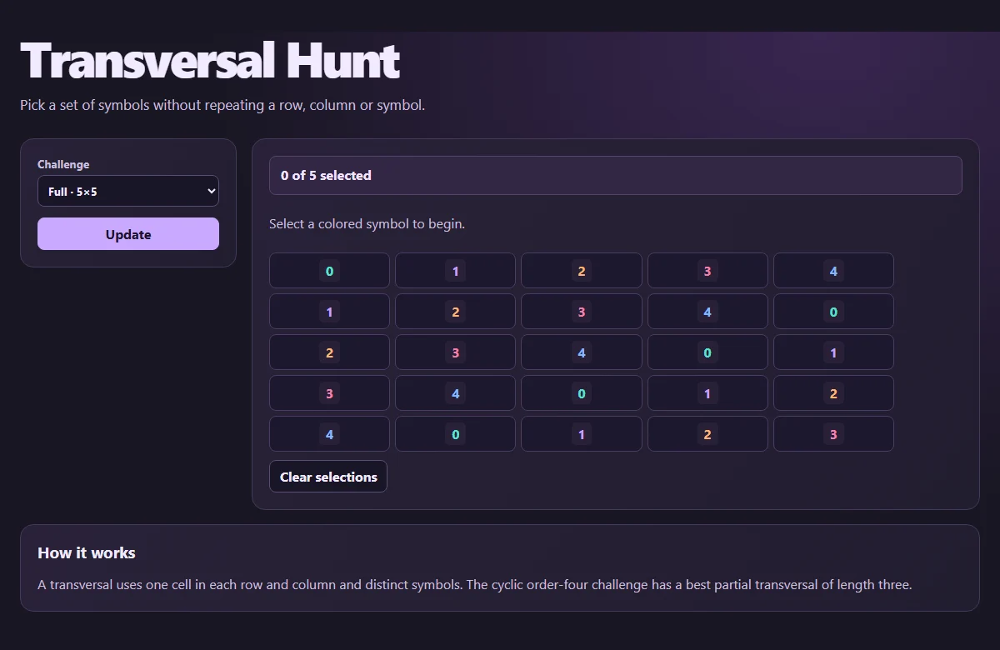

# Transversal Hunt

Pick a set of symbols without repeating a row, column or symbol.

[Open the web app](https://surfingcoder.com/apps/transversal-hunt/)



## Run locally

Serve the repository with Python 3, then open http://127.0.0.1:8000/ in a current browser.

```sh
python -m http.server 8000 --bind 127.0.0.1
```

Start with the provided example. Adjust the controls and select **Update** to recompute. Sliders refresh the result as you move them.

## Method

A transversal uses one cell in each row and column and distinct symbols. The cyclic order-four challenge has a best partial transversal of length three.

Inspired by Michael John Harris’s graduate proseminar, *On the Existence of Transversals in r-Multi Latin Squares* (2012).

## Verify

Run `node --test check.mjs` with Node.js 22 or newer. The check runs the app’s mathematical regression cases without a browser.
